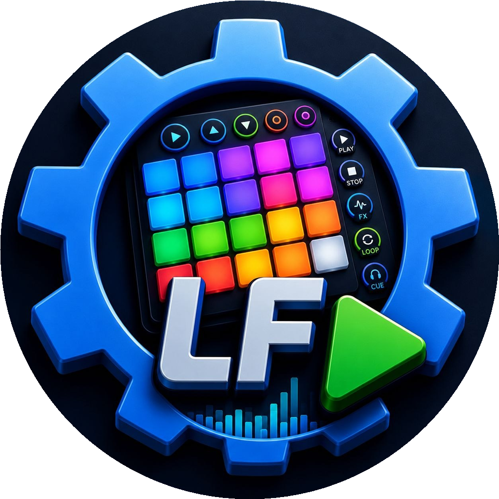
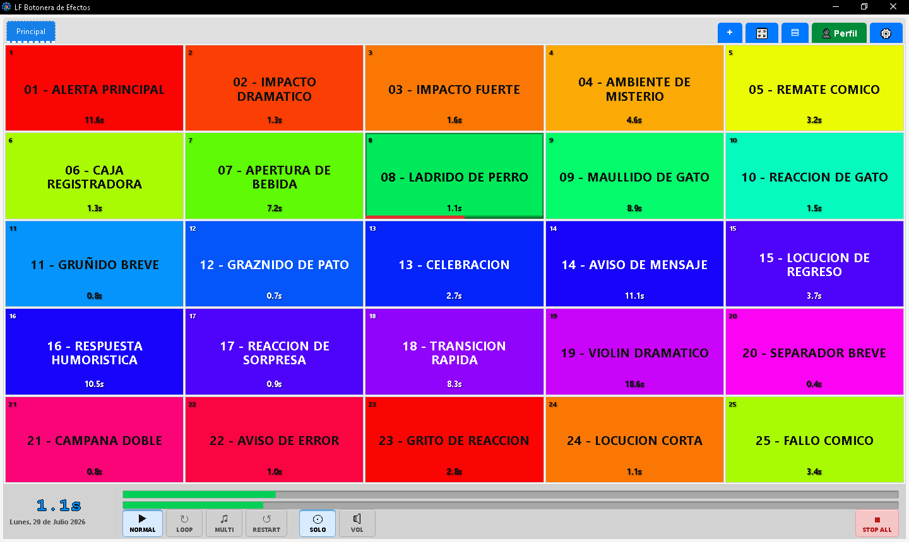
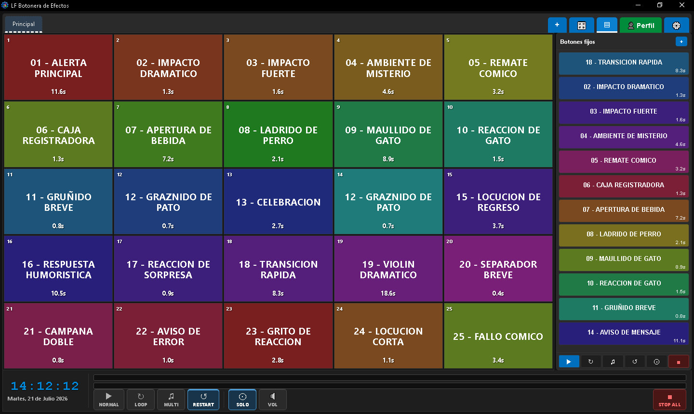
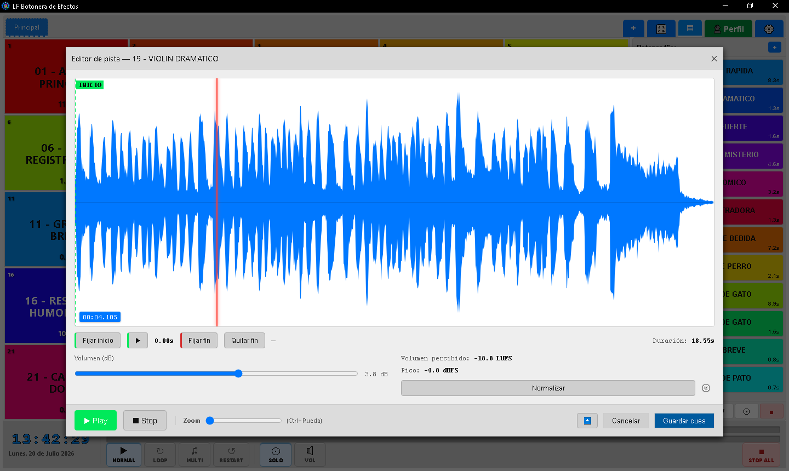

  
  <h1>LF Botonera de Efectos (Soundboard)</h1>
  
<strong>A soundboard for live radio, voice work and streaming.</strong>

  
Keep your sound effects, music beds, station IDs and voice clips ready to play. A desktop app for Windows and Linux, built for quick access and control during a live show.

[Español](README.md) · **English** · [Português (Brasil)](README.pt-BR.md) · [Português (Portugal)](README.pt-PT.md)

[Download](#download) · [Getting started](#getting-started) · [Features](#features) · [Help](#help-and-community) · [Development](#building-from-source)

## What is it?

**LF Botonera de Efectos** is a desktop soundboard for radio presenters, broadcast operators, producers, content creators and streamers. Arrange your audio on a grid of buttons and play the right sound when you need it.

## Screenshots

Windows screenshots with the interface in Spanish, taken in July 2026. The current version may look different.

See the dark theme and track editor

## Download

**[Get it from Microsoft Store](https://apps.microsoft.com/detail/9NJ8ST39QP7V)** (recommended for Windows, with automatic updates) · **[Direct downloads for Windows and Linux](https://github.com/yosoyluisfernando/LF-Botonera-de-efectos/releases/latest)**

| System | Package | Best for |
|---|---|---|
| Windows 10/11 | [Microsoft Store](https://apps.microsoft.com/detail/9NJ8ST39QP7V) | Simple installation and updates managed by the store |
| Windows 10/11 | EXE | Direct installation with a setup wizard |
| Windows 10/11 | MSI | Managed deployments or corporate environments |
| Ubuntu / Debian | DEB | Distributions that support Debian packages |
| Fedora / openSUSE | RPM | Distributions that support RPM packages |
| Linux | AppImage | A portable executable, with no installation required |

Windows requires **Windows 10 20H2 or later and WebView2 Runtime**, included with Windows 11 and updated versions of Windows 10. If you use the EXE/MSI edition, see the [Microsoft Store migration guide (Spanish)](Documentación/MIGRACION_MICROSOFT_STORE.md) to keep your settings when switching editions.

## Getting started

1. Install the app and complete the first-run wizard.
2. Drag an audio file onto an empty button, then click it to play.
3. Right-click a button to edit it and assign a keyboard shortcut.
4. Use tabs and profiles to organize your shows or sessions. See the [user manual (Spanish)](MANUAL.md) for details.

## Features

- **Your sounds within reach:** customizable buttons, profiles, tabs, keyboard shortcuts and MIDI control.
- **Background music:** a separate player with its own queue, volume and output. Stopping sound effects leaves the music playing.
- **Library and search:** find tracks and drag them to buttons or the player.
- **Audio preparation:** CUE monitoring, a waveform editor, gain adjustment and normalization.
- **Mic control:** temporarily lower the level of selected destinations, manually or automatically. It does not mix, record or broadcast microphone audio.
- **Four interface languages:** Spanish, English, Brazilian Portuguese and European Portuguese.

<strong>Explore all features</strong>

### Organization and playback

- Unlimited profiles and tabs, each with configurable button grids; separate audio settings per profile and an output device per tab.
- Custom button and tab colors that adapt to light and dark themes; emoji and icon identifiers.
- Native Rust audio engine using rodio and cpal, with simultaneous playback and mixing.
- Per-button looping, overlapping playback, restart on press and stop-other behavior. Global Normal, Loop, Multi, Restart, Solo and Stop All controls.
- Sequential folder playback: play the next file each time you press the button.
- Time announcements assembled from your configured audio clips; temperature and humidity announcements using weather data from Open-Meteo.

### Keyboard, MIDI and CUE monitoring

- Assign shortcuts to buttons, tabs and global actions, including player controls. Global shortcuts can work while the app is in the background; a visual mapping mode shows assignments on the grid.
- Select MIDI inputs and assign Note On, Control Change or Program Change messages to buttons, tabs and global actions.
- Route CUE monitoring to a separate audio device, such as headphones, to check a track before putting it on air.
- A floating preview panel shows the track name, progress, time and volume, with Stop and click-to-seek controls.

### Track editor

- Waveform display with applied gain and red highlights where audio would clip; zoom from 1× to 30× with a slider or Ctrl + mouse wheel.
- Set start and optional end points without changing the original file. Enable normalization to −14 LUFS with a −1 dBFS peak ceiling, then adjust gain manually in dB.
- Analysis progress and a persistent waveform cache make previously analyzed tracks faster to reopen.
- Playback controls include restart without overlapping copies, a Stop cycle (pause → return to the cue point → return to 0:00), playback from cue and a 60 fps playhead.
- Use the editor inside the main window or pop it out into a separate window.
- Edits belong to the file, so cue and gain settings apply to every button using it. These settings can also travel with exported tabs and profiles.

### Library, metadata and backups

- Browse Music, Effects, indexed folders and local drives in a separate Library window. Search from the fixed panel by filename, title, artist, album, genre or keywords.
- Folder changes update the Library automatically. Play a track on air, preview it in CUE, add it to the player or drag it to a button.
- Edit metadata and tags individually or in batches. Optionally rename files on disk or write supported metadata into a single Music track.
- Remove folders from the catalog without deleting their audio files; restore them within a configurable retention period of 30 to 365 days.
- A single `.lfbackup` holds your configuration and track database. **Audio files are not included.** Restore validates the backup, saves a safety copy of the current state and restarts the app.

### Performance and interface

- Configurable RAM preloading for the full profile, the visible tab or tracks as they are played. Choose a 32, 64, 128 or 256 MB cache budget and an expiry period for unused tracks; cached audio supports instant seeking to cue points.
- Light, dark and system themes; drag and drop audio files, reorder buttons with Alt + drag and reorder tabs by dragging.
- Live stereo meters, clock, date, countdown, undo/redo, adjustable button text, a setup wizard and update notifications.
- Automatic recovery when the selected audio device is unavailable at startup.

## Supported audio formats

MP3 · WAV · FLAC · OGG/Vorbis · OGG/Opus · AAC · M4A · AIFF. Decoding uses Symphonia, written in Rust, without paid proprietary decoding components.

## LF Automatizador compatibility

Exchange `.bdelf` button tabs and `.bdeplf` profiles with [LF Automatizador](https://github.com/yosoyluisfernando/lf-automatizador). Each app ignores fields specific to the other. Exports can include optional cue and gain metadata (`bdelf_tracks`): the soundboard restores it on import, adapting file paths to the destination computer; LF Automatizador ignores it.

## Building from source

You need [Node.js 20+ with npm](https://nodejs.org/), [stable Rust](https://rustup.rs/) and the [Tauri 2 prerequisites](https://tauri.app/start/prerequisites/) for your system.

From the repository folder, run `npm install`, then `npm run tauri build`. Installers are generated in `src-tauri/target/release/bundle/`. For development with live reload, use `npm run tauri dev`, or `DEV.bat` on Windows.

See [Building and versions (Spanish)](Documentación/COMPILACION_Y_VERSIONES.md) for build and release instructions, and [Architecture (Spanish)](Documentación/ARCHITECTURE.md) for the code layout. Read the [contribution guide (Spanish)](Documentación/CONTRIBUTING.md) before preparing a change.

## Windows signing

The direct EXE/MSI installers do not have a developer signing certificate, so Windows may display a warning when you first open them. Microsoft Store handles signing and updates for its own edition. The source code is public and the project is free software.

## Help and community

[Support and bug reports](SUPPORT.md) · [Official website](https://lfbotonera.blogspot.com/) · [News channel](https://t.me/+XKof2wDvGVw1YTRh) · [Community group](https://t.me/+bXppwWvJvSg5YjNh)

[Contributing](Documentación/CONTRIBUTING.md) · [Code of conduct](Documentación/CODE_OF_CONDUCT.md) · [Security](Documentación/SECURITY.md) · [Privacy](PRIVACY.md) · [Third-party notices](THIRD_PARTY_NOTICES.md)

Linked documentation is mainly in Spanish. The language selector changes the language of this overview.

## Support development

If the app helps with your shows, productions or streams, you can [support its maintenance through PayPal](https://www.paypal.com/donate/?hosted_button_id=3JJVFFBVR4MQQ).

## Development credits

**Author and creator: Luis Fernando Velásquez.**

This project was developed with assistance from artificial intelligence tools:

- **[Claude AI](https://claude.ai)** (Anthropic): assistance with Rust architecture, audio engine implementation, technical documentation and code review.
- **[Codex / GPT](https://openai.com)** (OpenAI): assistance during the early stages of development.

AI tools served as development assistants. Product design, architectural decisions, creative direction and authorship belong to the author.

## License

Copyright (C) 2026 **Luis Fernando Velásquez**. This is free software under **GNU GPL-3.0-or-later**, provided without any warranty. You may redistribute and modify it under the terms in [LICENSE](LICENSE).
